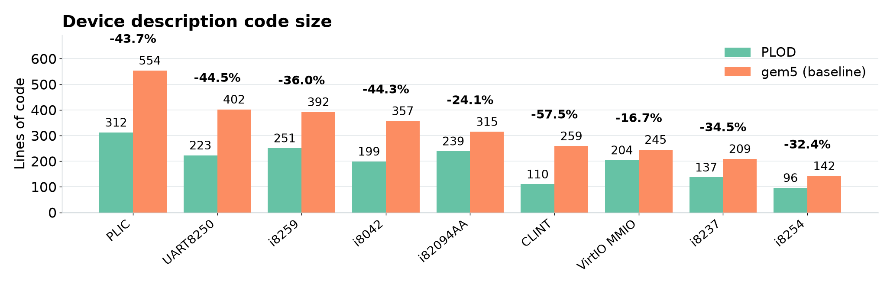

# Device source size comparison



The chart includes nine PLOD Ruby device descriptions with matching gem5 sources. Each gem5
value combines the device's `.cc` and `.hh` files from the sibling gem5 checkout;
each PLOD value counts the complete `lib/Devices/<device>.rb` file, including
abstract declarations.

The plot uses paired vertical bars, sorted by decreasing gem5 source size,
with mint green for PLOD and coral for gem5. Its layout follows the provided
`embench_ipc.png` reference.
The legend identifies gem5 as the baseline. Percentage labels above each pair
show the PLOD line-count change relative to gem5, the baseline.

The plotted metric is physical source lines containing code after removing
comments and blank lines. Brace-only lines, declarations, imports and C++
preprocessor directives count. Pygments lexers distinguish comments from string
literals. This metric depends on formatting and does not establish behavioral
equivalence. Target YAML, generated C++, Python SimObject configuration, PLOD
compiler code and shared native helpers (including Intel8254Timer) are excluded.

The CSV also records total physical lines and byte sizes, including comments
and blank lines. `device_code_size_inputs.json` records per-file counts, SHA-256
hashes and the gem5 revision. Percent change is `(PLOD / gem5 - 1) * 100`;
negative values mean fewer PLOD lines.

Regenerate from the repository root with Python, matplotlib and Pygments:

```sh
python3 docs/plots/compare_device_sizes.py --gem5-root ../gem5
```

Output files: `device_code_size.png`, `.svg`, `.pdf`, `.csv` and
`device_code_size_inputs.json`. Install plotting dependencies in a separate
environment; they are not required by the PLOD toolchain.
